# ELMS — Architecture & User Flows

This document walks through how the Employee Leave Management System is put together and how each kind of user moves through it. Every diagram is Mermaid, so it renders on GitHub, in VS Code (with a Mermaid extension) or at [mermaid.live](https://mermaid.live).

1. [System architecture](#1-system-architecture)
2. [Backend request pipeline](#2-backend-request-pipeline)
3. [Authentication & session refresh](#3-authentication--session-refresh)
4. [Data model](#4-data-model)
5. [Leave lifecycle](#5-leave-lifecycle)
6. [Applying for leave](#6-applying-for-leave)
7. [Two-level approval](#7-two-level-approval)
8. [User flows by role](#8-user-flows-by-role)
9. [Frontend structure](#9-frontend-structure)

---

## 1. System architecture

The repo is a **Turborepo** with three workspaces:

- **`apps/frontend`**: React 19 + Vite + Redux Toolkit + Tailwind. Runs in the browser.
- **`apps/backend`**: Express 5 + Prisma 7. A REST API under `/api/v1`.
- **`packages/shared`**: enums, leave policy, zod schemas, date helpers and API types. **Both apps import it**, so the browser and the server validate with exactly the same rules and messages.

The browser never talks to Express directly. In development the **Vite dev server** proxies `/api` to port 5000; in Docker **nginx** does the same. Because of that, the frontend and the API share one origin, and the HTTP-only auth cookies stay first-party.

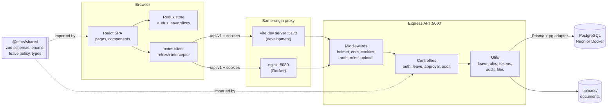

### Deployment options

| Mode | Command | What runs |
| --- | --- | --- |
| Development | `pnpm dev` | Vite on 5173 (proxies `/api`), Express via nodemon + tsx on 5000 |
| Production-style | `pnpm build && pnpm start` | `vite preview` on 5173, `node dist/index.js` on 5000 |
| Docker | `docker compose up --build -d` | `db` (Postgres 17), `backend` (runs migrations, then starts), `frontend` (nginx on 8080) |

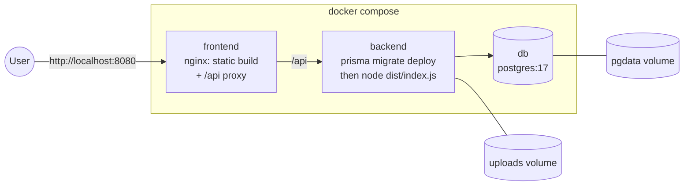

---

## 2. Backend request pipeline

Every request passes through the same chain. Controllers stay thin: they parse input with a shared zod schema and call helpers in `utils/leave.util.ts`, which holds the business rules (scoping, permissions, balance and overlap checks). **Anything thrown anywhere ends up in one error handler**, which turns it into a friendly JSON message. That includes zod, multer and Prisma errors. The same handler deletes any files multer already saved when a request fails.

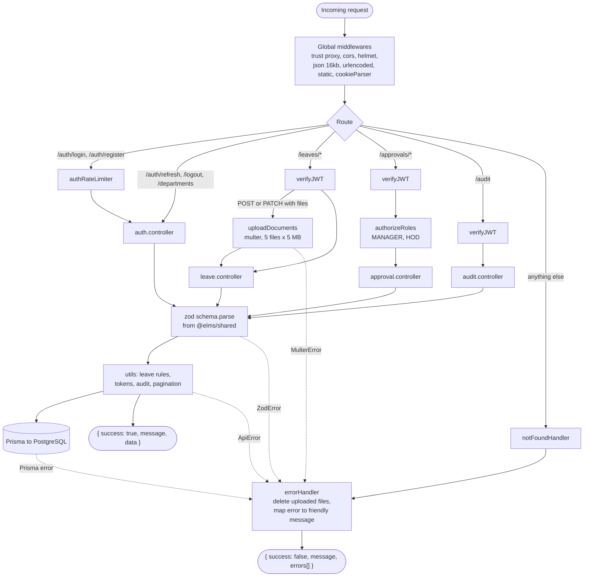

---

## 3. Authentication & session refresh

- Login issues a **15-minute access token** and a **7-day refresh token**, both stored in **HTTP-only cookies**. JavaScript can't read them, which protects against XSS.
- The refresh token is stored in the database **hashed** (SHA-256) and is **rotated** on every refresh. Logging out clears it, so a stolen old refresh token stops working.
- When the access token expires, the axios interceptor calls `/auth/refresh` once, even if several requests failed at the same moment, and then retries the original request. The user never sees it happen.
- If the refresh also fails, Redux marks the session as expired and the route guards send the user to `/auth/login`.

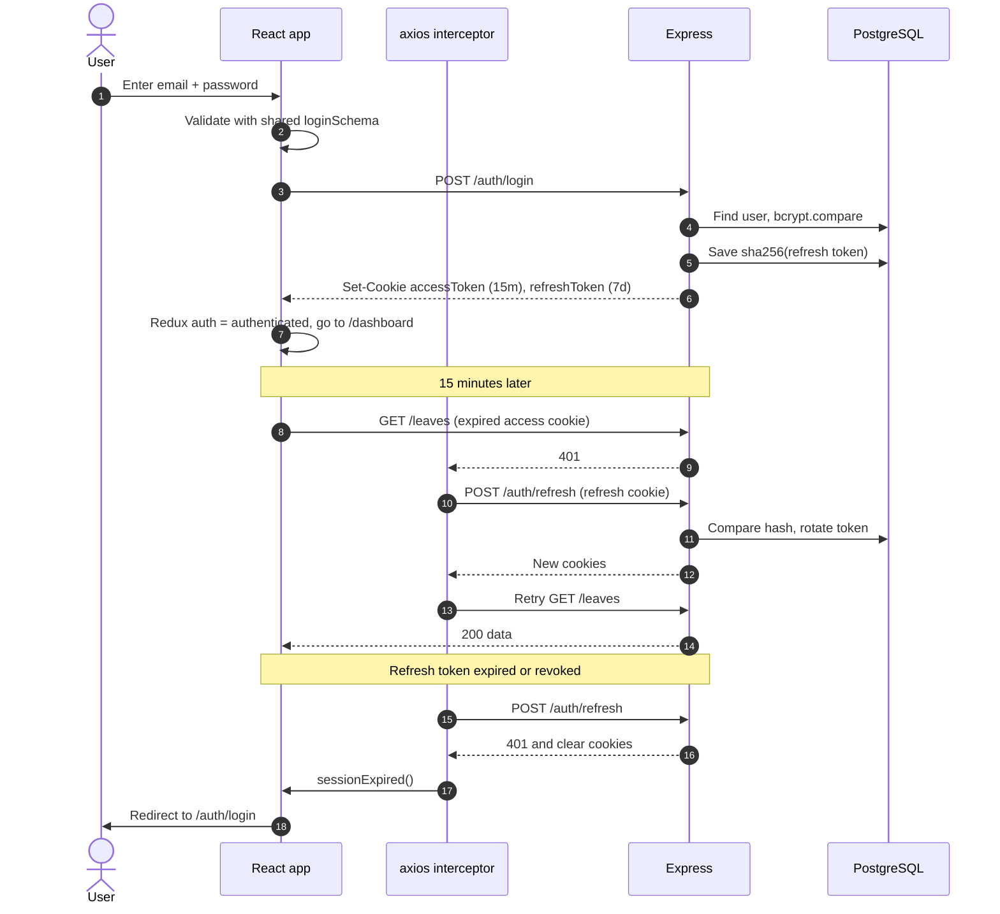

On page load, `main.tsx` dispatches `fetchMe()` (`GET /auth/me`). Until it answers, the guards show a loader instead of flashing the login page.

---

## 4. Data model

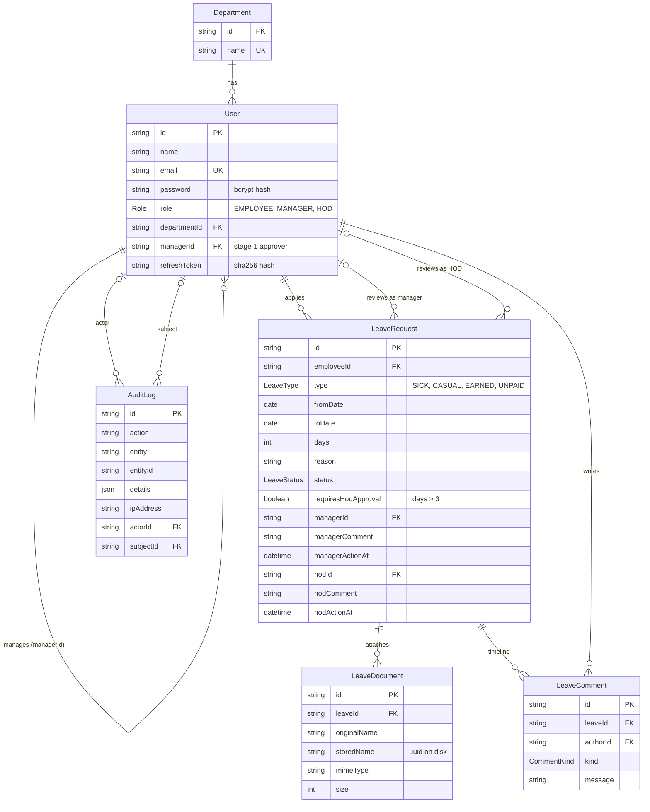

Notes:

- **The reporting line is `User.managerId`.** An employee points to their manager, a manager points to the HOD, and an HOD has none.
- **The HOD of a department** is whichever user has `role = HOD` and the same `departmentId`.
- **`LeaveComment` is the timeline**: system notes, approvals, rejections, info requests and replies. Both the employee and the reviewers see it.
- **`AuditLog.subjectId`** is the employee a log entry is about. It's used to scope who can see which logs.
- **Leave balances aren't stored.** They're calculated live from requests in `ACTIVE_STATUSES` against `LEAVE_POLICY`.

---

## 5. Leave lifecycle

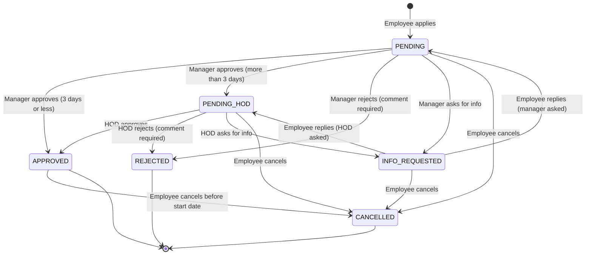

| Status | Meaning | Counts against balance? | Colour |
| --- | --- | --- | --- |
| `PENDING` | Waiting for the manager | Yes (held) | Amber |
| `PENDING_HOD` | Manager approved, waiting for the HOD | Yes (held) | Violet |
| `INFO_REQUESTED` | A reviewer asked the employee for more information | Yes (held) | Sky |
| `APPROVED` | Final | Yes (taken) | Emerald |
| `REJECTED` | Final, with a reason | No | Rose |
| `CANCELLED` | Withdrawn by the employee | No | Slate |

When the employee replies to an info request, the request goes back to **whichever stage asked**. If `managerActionAt` is set, the manager has already approved, so the question came from the HOD and the request returns to `PENDING_HOD`.

Editing is only allowed while the request is `PENDING` and the manager hasn't acted on it yet.

---

## 6. Applying for leave

The same checks run twice: first in the browser for instant feedback (shared zod schema plus the document rule), then on the server, which is the source of truth.

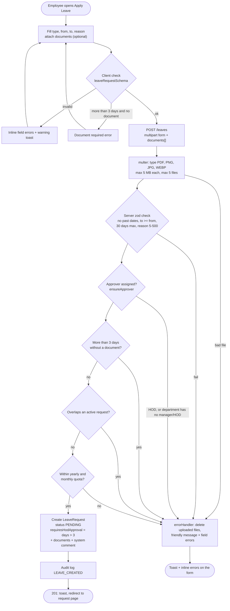

**Leave policy** (`LEAVE_POLICY` in `packages/shared/src/constants.ts`):

| Type | Yearly | Monthly |
| --- | --- | --- |
| Sick | 12 | 3 |
| Casual | 12 | 2 |
| Earned | 18 | none |
| Unpaid | unlimited (tracked) | none |

Pending requests count as used, so an employee can't submit several pending requests that together exceed the quota. A request that spans two months or years is split per month and checked against each limit.

---

## 7. Two-level approval

Leaves of **more than 3 consecutive days** need a document plus approval from **both** the employee's manager and their department's HOD.

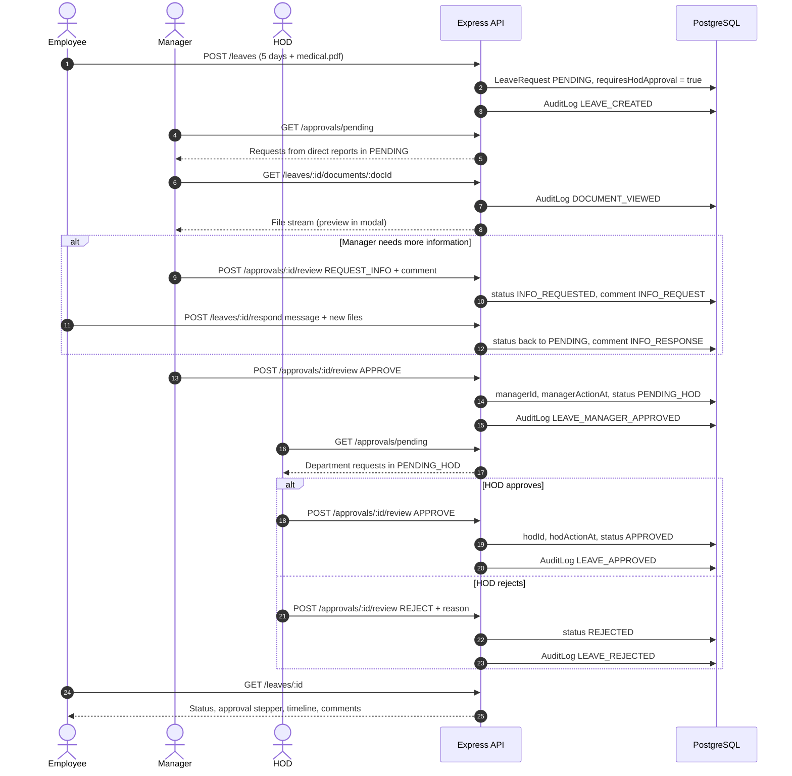

**Who can review what** (`canReviewLeave` in `utils/leave.util.ts`):

| Stage | Allowed reviewer |
| --- | --- |
| `PENDING` | Only the employee's own manager (`employee.managerId === reviewer.id`) |
| `PENDING_HOD` | Only an HOD in the employee's department |
| Any | Nobody can review their own leave |

If an HOD is someone's *direct* manager (for example, a manager's own leave), their single approval covers both stages.

The server works out the **permissions** (`canReview`, `canEdit`, `canCancel`, `canRespond`) and returns them with every leave. The frontend only shows the buttons the API would actually allow.

---

## 8. User flows by role

Every signed-in user is also an employee: managers and HODs can apply for leave too. Managers and HODs get extra **Team** pages, guarded on the frontend (`ProtectedRoute roles={REVIEWER_ROLES}`) **and** on the backend (`authorizeRoles`).

### 8.1 Site map and route guards

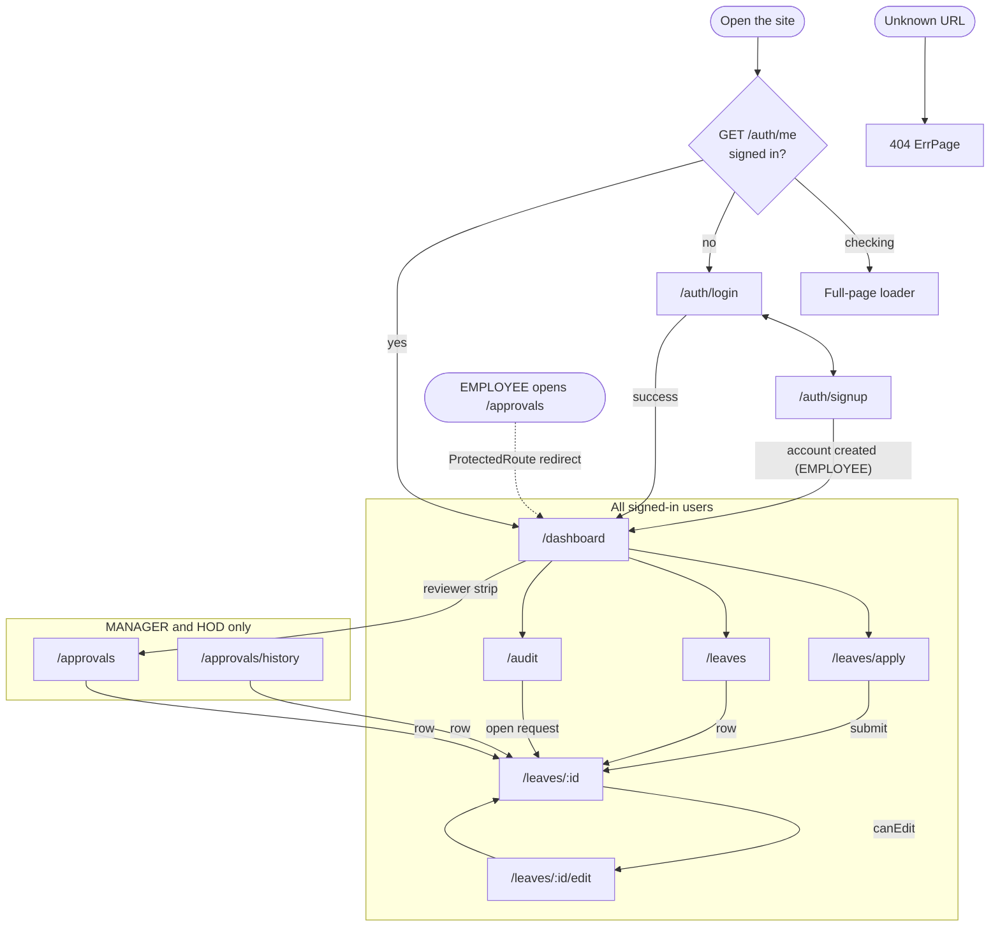

### 8.2 Employee journey

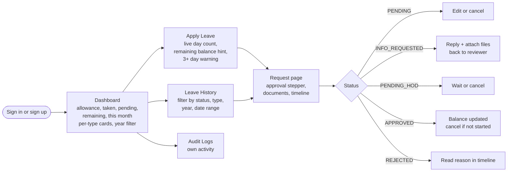

### 8.3 Manager / HOD journey

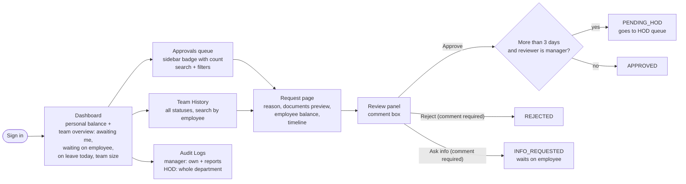

**What each role sees:**

| Screen | Employee | Manager | HOD |
| --- | --- | --- | --- |
| Dashboard balances, apply, history | ✅ | ✅ | ✅ (HODs can't submit: no approver above them) |
| Approvals queue | — | Direct reports in `PENDING` | Direct reports in `PENDING` + department in `PENDING_HOD` |
| Team history | — | Direct reports | Whole department |
| Audit logs | Own records | Own + direct reports | Whole department |
| View documents | Own requests | Reports' requests | Department requests |

---

## 9. Frontend structure

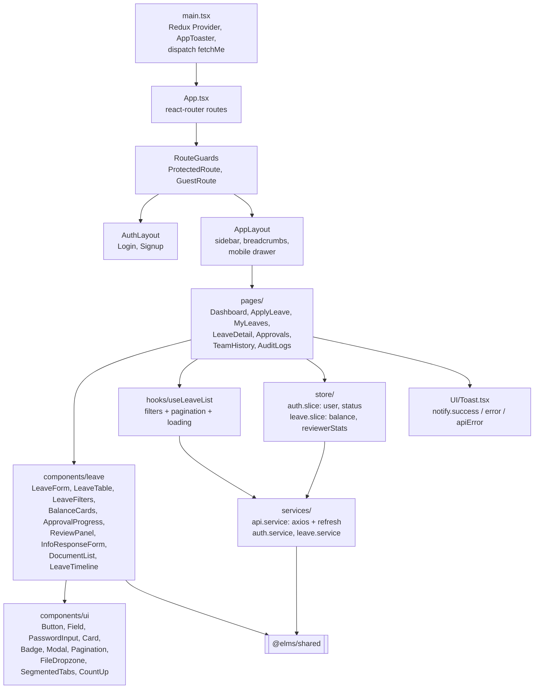

What lives where:

- **Redux** holds only data that several screens share: the signed-in user, the leave balance (dashboard, apply form), and the reviewer counters (sidebar badge, dashboard). Page-specific data, such as a leave's detail or a list page, stays in local state or in `useLeaveList`.
- **`useLeaveList`** is one hook behind every filterable list (My history, Approvals, Team history). Changing a filter resets the page to 1.
- **`constants/ui.constants.ts`** holds the colour maps for each status and leave type, plus the navigation config, so colour coding is consistent everywhere.
- **`utils/format.util.ts`** has `validateWith()` (runs a shared zod schema and returns field errors) and `getErrorMessage()`/`getFieldErrors()` (read the API's friendly error format).
